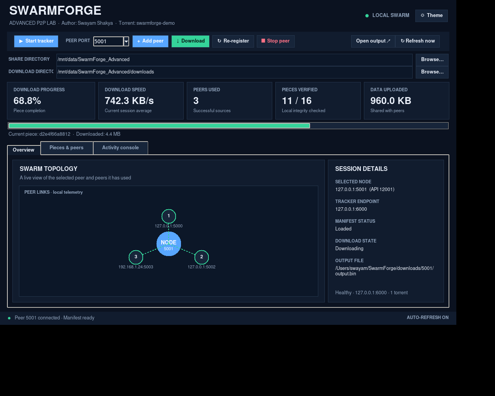

# SwarmForge — Advanced Edition 2.1.0

**Author: Swayam Shakya**

**SwarmForge** is a Python project for learning how peer-to-peer file sharing works. The tracker helps nodes discover other peers, while the nodes exchange file pieces directly over TCP. Each piece is checked before it is shared again. Piece IDs also include their position in the file, so repeated blocks do not get mixed up during reconstruction.

> This is a teaching implementation inspired by BitTorrent concepts, not a compatible implementation of the official BitTorrent protocol.

## GUI highlights (2.1.0)



- **Non-blocking interface:** network calls and polling run in worker threads; UI changes are applied on Tk's main thread.
- **Responsive layout:** resizable window, adaptive topology drawing, metric cards, and three focused tabs.
- **Live telemetry:** progress, average speed, peer history, piece counts, uploaded/downloaded bytes, current piece, and output path.
- **Interactive operations:** start tracker and peers, download, re-register, gracefully stop a selected peer, browse directories, open output, and manually refresh. Closing the window stops child processes in the background to avoid a UI freeze.
- **Investigation tools:** searchable/filterable activity log, export to `.log`, piece-state filtering, and dark/light theme toggle. Keyboard shortcuts: `F5` refresh, `Ctrl+L` activity console, `Ctrl+Shift+T` theme switch.
- **Health feedback:** tracker health check after launch and clear node connectivity status.

The GUI was smoke-tested under a virtual X display for construction, theme toggling, stats rendering, topology drawing, piece inventory, and logs. A GUI-driven integration test also started a tracker, seed, and empty leecher; the async download reached 100% and reconstructed the payload byte-for-byte. A native macOS launch should still be checked on the target machine.

## AI assistance

AI tools were used as a supporting resource during development for selected design discussions, troubleshooting, and wording improvements. SwarmForge does not call an AI model at runtime. The author remains responsible for reviewing the code, understanding the implementation, and following any course rules on acknowledging AI assistance.

## What you can learn

- Client/server versus peer-to-peer architecture
- TCP sockets, message framing, and concurrent request handling
- Tracker-based peer discovery and shared state
- Ordered manifests and piece-level SHA-256 integrity checks
- Rarest-first piece selection and retry/failure handling
- Swarm propagation: a leecher becomes a seed after verifying downloaded pieces
- Live progress, upload/download counters, tracker leases, and transfer telemetry
- Arbitrary-file splitting with repeatable piece manifests
- Unit testing, integration testing, throughput benchmarks, and repeatable experiments

## Project structure

| File | Purpose |
|---|---|
| `tracker.py` | Concurrent TCP tracker; stores torrent manifests and piece owners |
| `node.py` | Peer server/client, piece downloader, hash verification, re-seeding, local GUI API |
| `gui.py` | Responsive Tkinter dashboard with non-blocking API calls, theme switch, topology view, piece filters, searchable logs, export, and peer lifecycle controls |
| `control.py` | Terminal client for a running node's API |
| `torrent.py`, `torrent_data.py` | In-memory torrent metadata and piece-selection helpers |
| `config.py` | Shared defaults, with environment-variable overrides for isolated experiments |
| `utils.py`, `logger.py` | JSON-line control framing, hashing, and logging |
| `tests/test_core.py` | Fast unit tests for hashing, message framing, and metadata |
| `scripts/smoke_test.py` | End-to-end test: full seed + partial seed → leecher → second leecher |
| `scripts/prepare_torrent.py` | Split any input file into ordered pieces and print required environment settings |
| `scripts/benchmark.py` | Repeatable local throughput and byte-for-byte integrity experiment |
| `TEST_RESULTS.md` | Latest verification record and commands to reproduce it |
| `SECURITY.md` | Safe-use notes and prototype security limitations |
| `tests/test_tracker.py` | Tracker registration, manifest, heartbeat, and unregister tests |
| `tests/test_prepare_torrent.py` | Arbitrary-file preparation tests, including repeated and empty chunks |
| `REPORT.md`, `ARCHITECTURE.md`, `DEMO.md`, `LEARNING_GUIDE.md`, `CHANGELOG.md` | Report, protocol/design notes, demo checklist, guided exercises, and implementation notes |
| `binfile.part1.bin`, `binfile.part2.bin` | Tiny sample pieces for a repeatable demonstration |

No third-party Python packages are required. JSON is used only for network control messages; there is no `.json` configuration or torrent manifest file.

## Requirements

- Python 3.10 or newer recommended
- Tkinter for the desktop GUI (`python3 -m tkinter` can check availability)
- A terminal or VS Code

## Quick start: GUI

Open this folder in a terminal and run:

```bash
python3 --version
python3 -m py_compile config.py logger.py utils.py torrent_data.py torrent.py tracker.py node.py gui.py control.py
python3 gui.py
```

1. Click **Start tracker**.
2. Start a seed node on port `5000` with the project folder as its share directory.
3. Start a second node on port `5001`.
4. Select a node and click **Download from peers**.
5. Inspect the live logs and the `downloads/<port>/output.bin` output.

The starter GUI seeds both nodes from the included sample pieces. For the more informative **pure-leecher experiment**, use the terminal steps below with an empty share directory.

## Terminal demo

Open separate terminal tabs in this folder.

**Terminal 1 — tracker**

```bash
python3 tracker.py
```

**Terminal 2 — seed**

```bash
python3 node.py 5000 --share-dir . --output-dir downloads/seed
```

**Terminal 3 — empty leecher**

Create an empty folder named `empty-seed` first, then run:

```bash
python3 node.py 5001 --share-dir empty-seed --output-dir downloads/5001
```

**Terminal 4 — request the download**

```bash
python3 control.py 5001 download
python3 control.py 5001 stats
python3 control.py 5001 logs
```

After the download, the node has verified piece files and advertises them to the tracker. Start another empty node on port `5002` with a different output directory and request a download; the second leecher can receive data from the first leecher, demonstrating swarm propagation.

## Run the tests

Fast unit tests:

```bash
python3 -m unittest discover -s tests -v
```

End-to-end integration smoke test (starts local subprocesses and uses temporary folders):

```bash
python3 scripts/smoke_test.py
python3 scripts/benchmark.py --megabytes 4 --piece-kib 256
```

The integration test checks the important distributed behavior: the first empty peer discovers the seed's manifest, downloads and verifies pieces, reconstructs the file, and then serves those pieces to a second empty peer. It uses temporary test data and an isolated tracker port.

## Distribute your own file

The helper splits an arbitrary file into configured piece files. It prints the environment variables that every tracker/node in that swarm must share:

```bash
python3 scripts/prepare_torrent.py ./myfile.zip --pieces-dir ./myfile_pieces --piece-size 262144
```

Copy the printed `export SWARMFORGE_...` lines into each terminal, then start `tracker.py`, a seed node whose `--share-dir` is the generated pieces directory, and one or more empty peers. The final reconstructed file uses the original filename. Keep the generated piece filenames and their order identical for all nodes. The helper does not upload or transmit your file; it only prepares local piece files.

## Advanced reliability features

- **Tracker leases:** nodes periodically heartbeat their currently verified piece IDs; stale registrations are pruned after a lease timeout.
- **Graceful departure:** a node attempts to unregister itself from the tracker during normal shutdown.
- **Position-aware piece IDs:** the same SHA-256 digest may appear in multiple positions without collapsing those pieces.
- **Integrity checks:** each received piece must match both the manifest size and digest before it is published locally.
- **Atomic writes:** a piece or reconstructed output is written to a temporary file and renamed only after writing completes.
- **Benchmark:** `scripts/benchmark.py` measures a local transfer and compares the result byte-for-byte. Results depend on hardware, OS, and background load; they are not universal performance claims.

## Configuration overrides

Default behavior is local-only (`127.0.0.1`). You can override settings using environment variables:

| Variable | Default | Purpose |
|---|---|---|
| `SWARMFORGE_HOST` | `127.0.0.1` | Address peers/tracker bind to |
| `SWARMFORGE_TRACKER_HOST` | value of `SWARMFORGE_HOST` | Tracker address used by nodes |
| `SWARMFORGE_TRACKER_PORT` | `6000` | Tracker TCP port |
| `SWARMFORGE_API_BASE_PORT` | `7000` | Node API port is base + peer port |
| `SWARMFORGE_TORRENT_ID` | `swarmforge-demo` | Identifier separating swarms |
| `SWARMFORGE_PIECE_FILES` | `binfile.part1.bin,binfile.part2.bin` | Ordered seed filenames |
| `SWARMFORGE_CHUNK_SIZE` | `65536` | Bytes read/sent per block |
| `SWARMFORGE_SOCKET_TIMEOUT` | `5` | Socket timeout in seconds |
| `SWARMFORGE_MAX_RETRIES` | `3` | Piece download retry rounds |

All peers in one swarm must use the same torrent ID and compatible manifest. For multi-machine use, configure a reachable tracker host and reachable peer addresses; the default is intentionally restricted to localhost.

## Protocol at a glance

- `register`: a peer advertises its endpoint and locally available piece hashes. A complete seed can establish the ordered manifest.
- `get_manifest`: a joining peer obtains the canonical ordered piece list, even if it has no seed files.
- `get_peers`: returns endpoints currently advertising a requested piece.
- `get_piece`: direct peer-to-peer transfer. A newline-delimited JSON header is followed by raw bytes.
- `announce`: after a piece passes SHA-256 verification, the downloader advertises it so other peers can request it.
- `stats` / `logs` / `download`: local API operations used by the GUI and `control.py`.

## Limitations and responsible use

- The tracker is centralized; there is no DHT, NAT traversal, encryption, authentication, or Internet-wide discovery.
- This is not the real BitTorrent wire protocol and should not be exposed to untrusted networks.
- The protocol trusts the first complete seed's manifest for piece ordering; hashes detect piece corruption, but this version does not authenticate who published the manifest.
- Pieces are downloaded as whole pieces into memory, so it is intended for small educational files, not production-scale transfers.
- The GUI uses local node APIs. Its source compiles, but this build environment had no usable desktop display, so launch and visually verify it on the target computer before a live presentation.

See `ARCHITECTURE.md` for design details and experiments that can make this a stronger learning project.
